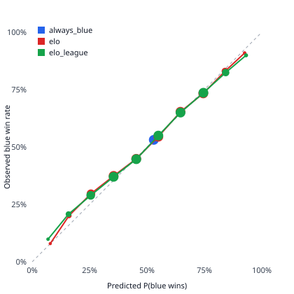

# Win-model evaluation run `20261112-174031-a2cf8a3cf9`

Walk-forward evaluation before the frozen holdout · games 2024-01-01 to 2026-05-11 · 24,660 games in 12,805 series · holdout starts 2026-05-12 · data cutoff 2026-11-12 · seed 0 · code a2cf8a3cf9 · A1 baselines

Each day's games are predicted by models refitted on all earlier days. Intervals are 95% bootstrap intervals resampling whole series; "vs baseline" rows are paired differences (negative = better than `elo`).

## All leagues (24,660 games)

| Model | Log-loss | Brier | Accuracy | AUC | Calibration slope | ECE |
|---|---|---|---|---|---|---|
| always_blue | 0.6912 [0.6905, 0.6920] | 0.2490 [0.2487, 0.2494] | 53.1% [52.5%, 53.7%] | 0.4929 [0.4860, 0.5000] | 0.0145 [0.0114, 0.0175] | 0.0017 [0.0001, 0.0080] |
| elo | 0.6389 [0.6346, 0.6434] | 0.2242 [0.2223, 0.2262] | 63.1% [62.5%, 63.7%] | 0.6808 [0.6736, 0.6873] | 0.9142 [0.8722, 0.9543] | 0.0115 [0.0088, 0.0177] |
| elo_league | 0.6335 [0.6289, 0.6384] | 0.2217 [0.2197, 0.2239] | 63.8% [63.1%, 64.4%] | 0.6899 [0.6825, 0.6967] | 0.9002 [0.8606, 0.9387] | 0.0106 [0.0081, 0.0175] |

| Model | Log-loss vs baseline | Brier vs baseline |
|---|---|---|
| always_blue | +0.0524 [+0.0478, +0.0567] | +0.0248 [+0.0228, +0.0268] |
| elo_league | -0.0054 [-0.0074, -0.0033] | -0.0025 [-0.0033, -0.0016] |

## Major leagues (+ Worlds/MSI/FST/EWC) (6,233 games)

| Model | Log-loss | Brier | Accuracy | AUC | Calibration slope | ECE |
|---|---|---|---|---|---|---|
| always_blue | 0.6912 [0.6897, 0.6926] | 0.2490 [0.2483, 0.2497] | 53.2% [52.0%, 54.4%] | 0.4927 [0.4786, 0.5065] | 0.0146 [0.0097, 0.0205] | 0.0020 [0.0002, 0.0146] |
| elo | 0.6367 [0.6268, 0.6464] | 0.2229 [0.2187, 0.2272] | 64.0% [62.8%, 65.3%] | 0.6891 [0.6761, 0.7015] | 0.8077 [0.7507, 0.8707] | 0.0246 [0.0194, 0.0402] |
| elo_league | 0.6302 [0.6200, 0.6404] | 0.2201 [0.2156, 0.2243] | 64.5% [63.3%, 65.8%] | 0.6979 [0.6849, 0.7111] | 0.8287 [0.7691, 0.8942] | 0.0220 [0.0176, 0.0367] |

| Model | Log-loss vs baseline | Brier vs baseline |
|---|---|---|
| always_blue | +0.0545 [+0.0446, +0.0643] | +0.0261 [+0.0218, +0.0304] |
| elo_league | -0.0065 [-0.0101, -0.0027] | -0.0029 [-0.0045, -0.0012] |

## ERLs (EMEA regional + EMEA Masters) (7,332 games)

| Model | Log-loss | Brier | Accuracy | AUC | Calibration slope | ECE |
|---|---|---|---|---|---|---|
| always_blue | 0.6910 [0.6897, 0.6924] | 0.2489 [0.2483, 0.2496] | 53.3% [52.1%, 54.4%] | 0.5028 [0.4906, 0.5181] | 0.0154 [0.0105, 0.0203] | 0.0033 [0.0003, 0.0138] |
| elo | 0.6362 [0.6288, 0.6437] | 0.2232 [0.2199, 0.2266] | 63.1% [61.9%, 64.2%] | 0.6816 [0.6696, 0.6938] | 1.0202 [0.9515, 1.0950] | 0.0110 [0.0090, 0.0238] |
| elo_league | 0.6325 [0.6243, 0.6406] | 0.2213 [0.2176, 0.2249] | 63.6% [62.5%, 64.8%] | 0.6899 [0.6787, 0.7018] | 0.9545 [0.8849, 1.0293] | 0.0085 [0.0068, 0.0221] |

| Model | Log-loss vs baseline | Brier vs baseline |
|---|---|---|
| always_blue | +0.0548 [+0.0475, +0.0620] | +0.0257 [+0.0224, +0.0289] |
| elo_league | -0.0037 [-0.0077, +0.0001] | -0.0019 [-0.0036, -0.0003] |

## Other leagues (11,095 games)

| Model | Log-loss | Brier | Accuracy | AUC | Calibration slope | ECE |
|---|---|---|---|---|---|---|
| always_blue | 0.6914 [0.6903, 0.6924] | 0.2491 [0.2486, 0.2496] | 53.0% [52.1%, 53.9%] | 0.4862 [0.4755, 0.4955] | 0.0138 [0.0095, 0.0176] | 0.0005 [0.0001, 0.0096] |
| elo | 0.6418 [0.6355, 0.6483] | 0.2256 [0.2228, 0.2285] | 62.6% [61.5%, 63.5%] | 0.6760 [0.6664, 0.6867] | 0.9391 [0.8748, 1.0066] | 0.0080 [0.0085, 0.0198] |
| elo_league | 0.6360 [0.6291, 0.6433] | 0.2230 [0.2200, 0.2261] | 63.4% [62.5%, 64.4%] | 0.6859 [0.6759, 0.6971] | 0.9237 [0.8597, 0.9941] | 0.0123 [0.0095, 0.0229] |

| Model | Log-loss vs baseline | Brier vs baseline |
|---|---|---|
| always_blue | +0.0496 [+0.0429, +0.0557] | +0.0235 [+0.0205, +0.0263] |
| elo_league | -0.0058 [-0.0088, -0.0030] | -0.0026 [-0.0039, -0.0015] |

## Calibration (all leagues)

| Model | 0.0-0.1 | 0.1-0.2 | 0.2-0.3 | 0.3-0.4 | 0.4-0.5 | 0.5-0.6 | 0.6-0.7 | 0.7-0.8 | 0.8-0.9 | 0.9-1.0 |
|---|---|---|---|---|---|---|---|---|---|---|
| always_blue (observed / predicted, n) | — | — | — | — | — | 0.53 / 0.53 (24660) | — | — | — | — |
| elo (observed / predicted, n) | 0.08 / 0.08 (126) | 0.20 / 0.16 (692) | 0.30 / 0.26 (1631) | 0.37 / 0.35 (3042) | 0.45 / 0.45 (4909) | 0.54 / 0.55 (5959) | 0.65 / 0.65 (4408) | 0.73 / 0.75 (2540) | 0.83 / 0.84 (1154) | 0.91 / 0.93 (199) |
| elo_league (observed / predicted, n) | 0.10 / 0.07 (193) | 0.21 / 0.16 (829) | 0.29 / 0.25 (1693) | 0.37 / 0.35 (2963) | 0.45 / 0.45 (4735) | 0.55 / 0.55 (5890) | 0.65 / 0.65 (4180) | 0.74 / 0.75 (2498) | 0.82 / 0.84 (1301) | 0.90 / 0.93 (378) |

## Roster changes

880 of 24,660 evaluated games (3.6%) involve a team that changed 3 or more players since its previous game. Strength is keyed by team name, so those games start from a rating earned by a different roster.

## Models

- **always_blue**: params {}; features: side
- **elo**: params {'k': 24.0}; features: elo_diff/400 (pre-game, win/loss Elo); intercept = side
- **elo_league**: params {'k': 24.0}; features: (elo + league offset) diff/400, offsets refitted monthly on past games; intercept = side