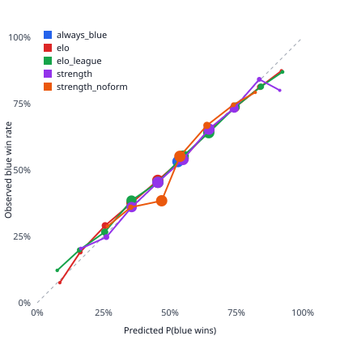

> **Superseded:** both strength models ran with UNTUNED default params (the tuning script crashed before writing *_tuned.json). Do not use for A2 conclusions.

# Win-model evaluation run `20261112-183600-145ce3fcf6`

Walk-forward evaluation before the frozen holdout · games 2025-01-11 to 2026-05-11 · 14,456 games in 7,044 series · holdout starts 2026-05-12 · data cutoff 2026-11-12 · seed 0 · code 145ce3fcf6 · A2: strength vs strength_noform, both tuned on 2024 only; first-pick term not identifiable before 2026

Each day's games are predicted by models refitted on all earlier days. Intervals are 95% bootstrap intervals resampling whole series; "vs baseline" rows are paired differences (negative = better than `elo`).

## All leagues (14,456 games)

| Model | Log-loss | Brier | Accuracy | AUC | Calibration slope | ECE |
|---|---|---|---|---|---|---|
| always_blue | 0.6912 [0.6903, 0.6921] | 0.2490 [0.2486, 0.2495] | 53.2% [52.4%, 53.9%] | — | — | 0.0017 [0.0001, 0.0097] |
| elo | 0.6427 [0.6370, 0.6486] | 0.2259 [0.2234, 0.2285] | 62.5% [61.7%, 63.4%] | 0.6741 [0.6644, 0.6824] | 0.9004 [0.8476, 0.9500] | 0.0111 [0.0082, 0.0200] |
| elo_league | 0.6381 [0.6319, 0.6444] | 0.2236 [0.2209, 0.2263] | 63.2% [62.4%, 64.1%] | 0.6827 [0.6735, 0.6914] | 0.8852 [0.8295, 0.9397] | 0.0108 [0.0090, 0.0209] |
| strength | 0.6501 [0.6452, 0.6550] | 0.2293 [0.2271, 0.2316] | 61.5% [60.7%, 62.3%] | 0.6600 [0.6518, 0.6697] | 0.9815 [0.9226, 1.0475] | 0.0069 [0.0050, 0.0171] |
| strength_noform | 0.6724 [0.6696, 0.6751] | 0.2398 [0.2384, 0.2411] | 58.0% [57.1%, 58.8%] | 0.6419 [0.6320, 0.6513] | 1.4162 [1.2567, 1.5599] | 0.0257 [0.0186, 0.0355] |

| Model | Log-loss vs baseline | Brier vs baseline |
|---|---|---|
| always_blue | +0.0485 [+0.0428, +0.0542] | +0.0231 [+0.0205, +0.0257] |
| elo_league | -0.0045 [-0.0072, -0.0019] | -0.0023 [-0.0034, -0.0012] |
| strength | +0.0074 [+0.0035, +0.0110] | +0.0034 [+0.0017, +0.0050] |
| strength_noform | +0.0297 [+0.0243, +0.0349] | +0.0139 [+0.0115, +0.0162] |

## Major leagues (+ Worlds/MSI/FST/EWC) (4,056 games)

| Model | Log-loss | Brier | Accuracy | AUC | Calibration slope | ECE |
|---|---|---|---|---|---|---|
| always_blue | 0.6913 [0.6894, 0.6932] | 0.2491 [0.2481, 0.2500] | 53.1% [51.5%, 54.7%] | — | — | 0.0009 [0.0003, 0.0169] |
| elo | 0.6400 [0.6278, 0.6519] | 0.2243 [0.2189, 0.2295] | 63.5% [61.9%, 65.1%] | 0.6844 [0.6674, 0.7024] | 0.8170 [0.7358, 0.9069] | 0.0238 [0.0198, 0.0407] |
| elo_league | 0.6347 [0.6217, 0.6470] | 0.2220 [0.2164, 0.2274] | 63.9% [62.2%, 65.6%] | 0.6917 [0.6759, 0.7101] | 0.8211 [0.7544, 0.9111] | 0.0242 [0.0179, 0.0401] |
| strength | 0.6474 [0.6377, 0.6570] | 0.2280 [0.2235, 0.2325] | 62.0% [60.4%, 63.6%] | 0.6664 [0.6495, 0.6844] | 0.9631 [0.8687, 1.0771] | 0.0068 [0.0084, 0.0280] |
| strength_noform | 0.6640 [0.6591, 0.6687] | 0.2357 [0.2333, 0.2380] | 60.3% [58.7%, 61.8%] | 0.6687 [0.6526, 0.6858] | 2.1051 [1.8254, 2.4192] | 0.0462 [0.0308, 0.0608] |

| Model | Log-loss vs baseline | Brier vs baseline |
|---|---|---|
| always_blue | +0.0513 [+0.0394, +0.0634] | +0.0248 [+0.0196, +0.0302] |
| elo_league | -0.0053 [-0.0101, -0.0007] | -0.0023 [-0.0043, -0.0003] |
| strength | +0.0074 [+0.0002, +0.0151] | +0.0038 [+0.0005, +0.0072] |
| strength_noform | +0.0239 [+0.0142, +0.0341] | +0.0114 [+0.0071, +0.0159] |

## ERLs (EMEA regional + EMEA Masters) (5,072 games)

| Model | Log-loss | Brier | Accuracy | AUC | Calibration slope | ECE |
|---|---|---|---|---|---|---|
| always_blue | 0.6902 [0.6886, 0.6918] | 0.2486 [0.2478, 0.2493] | 53.9% [52.6%, 55.2%] | — | — | 0.0094 [0.0006, 0.0231] |
| elo | 0.6323 [0.6230, 0.6420] | 0.2215 [0.2173, 0.2259] | 63.5% [62.0%, 65.0%] | 0.6854 [0.6682, 0.6995] | 1.0475 [0.9544, 1.1458] | 0.0084 [0.0088, 0.0255] |
| elo_league | 0.6307 [0.6204, 0.6413] | 0.2205 [0.2159, 0.2251] | 63.9% [62.5%, 65.4%] | 0.6904 [0.6735, 0.7062] | 0.9572 [0.8671, 1.0563] | 0.0125 [0.0110, 0.0290] |
| strength | 0.6456 [0.6371, 0.6544] | 0.2271 [0.2233, 0.2312] | 62.4% [60.9%, 63.8%] | 0.6680 [0.6530, 0.6820] | 1.0432 [0.9485, 1.1646] | 0.0143 [0.0110, 0.0294] |
| strength_noform | 0.6749 [0.6699, 0.6804] | 0.2409 [0.2386, 0.2435] | 58.3% [56.8%, 59.6%] | 0.6356 [0.6192, 0.6531] | 1.0659 [0.8599, 1.3114] | 0.0363 [0.0249, 0.0515] |

| Model | Log-loss vs baseline | Brier vs baseline |
|---|---|---|
| always_blue | +0.0579 [+0.0487, +0.0670] | +0.0270 [+0.0228, +0.0312] |
| elo_league | -0.0016 [-0.0057, +0.0028] | -0.0010 [-0.0028, +0.0007] |
| strength | +0.0133 [+0.0075, +0.0193] | +0.0056 [+0.0030, +0.0083] |
| strength_noform | +0.0426 [+0.0338, +0.0508] | +0.0194 [+0.0155, +0.0231] |

## Other leagues (5,328 games)

| Model | Log-loss | Brier | Accuracy | AUC | Calibration slope | ECE |
|---|---|---|---|---|---|---|
| always_blue | 0.6920 [0.6904, 0.6935] | 0.2494 [0.2486, 0.2502] | 52.5% [51.2%, 53.8%] | — | — | 0.0050 [0.0003, 0.0169] |
| elo | 0.6546 [0.6451, 0.6638] | 0.2313 [0.2270, 0.2353] | 60.8% [59.4%, 62.2%] | 0.6546 [0.6391, 0.6695] | 0.8566 [0.7647, 0.9558] | 0.0147 [0.0116, 0.0291] |
| elo_league | 0.6477 [0.6377, 0.6571] | 0.2279 [0.2236, 0.2321] | 62.1% [60.8%, 63.5%] | 0.6685 [0.6523, 0.6850] | 0.8875 [0.7929, 0.9960] | 0.0096 [0.0097, 0.0257] |
| strength | 0.6564 [0.6481, 0.6644] | 0.2323 [0.2285, 0.2360] | 60.3% [58.9%, 61.7%] | 0.6471 [0.6315, 0.6647] | 0.9367 [0.8391, 1.0450] | 0.0094 [0.0081, 0.0242] |
| strength_noform | 0.6764 [0.6722, 0.6807] | 0.2418 [0.2398, 0.2438] | 56.1% [54.6%, 57.5%] | 0.6270 [0.6111, 0.6440] | 1.3990 [1.1485, 1.6829] | 0.0131 [0.0099, 0.0283] |

| Model | Log-loss vs baseline | Brier vs baseline |
|---|---|---|
| always_blue | +0.0374 [+0.0285, +0.0469] | +0.0181 [+0.0141, +0.0224] |
| elo_league | -0.0068 [-0.0112, -0.0025] | -0.0034 [-0.0052, -0.0016] |
| strength | +0.0019 [-0.0042, +0.0078] | +0.0010 [-0.0017, +0.0036] |
| strength_noform | +0.0219 [+0.0128, +0.0308] | +0.0105 [+0.0064, +0.0145] |

## Calibration (all leagues)

| Model | 0.0-0.1 | 0.1-0.2 | 0.2-0.3 | 0.3-0.4 | 0.4-0.5 | 0.5-0.6 | 0.6-0.7 | 0.7-0.8 | 0.8-0.9 | 0.9-1.0 |
|---|---|---|---|---|---|---|---|---|---|---|
| always_blue (observed / predicted, n) | — | — | — | — | — | 0.53 / 0.53 (14456) | — | — | — | — |
| elo (observed / predicted, n) | 0.08 / 0.08 (53) | 0.19 / 0.16 (388) | 0.29 / 0.26 (926) | 0.38 / 0.36 (1813) | 0.46 / 0.45 (2901) | 0.54 / 0.55 (3474) | 0.65 / 0.65 (2679) | 0.74 / 0.74 (1482) | 0.81 / 0.84 (661) | 0.87 / 0.92 (79) |
| elo_league (observed / predicted, n) | 0.12 / 0.08 (82) | 0.20 / 0.16 (472) | 0.27 / 0.25 (969) | 0.39 / 0.35 (1740) | 0.45 / 0.45 (2791) | 0.55 / 0.55 (3490) | 0.64 / 0.65 (2535) | 0.74 / 0.75 (1437) | 0.81 / 0.84 (764) | 0.87 / 0.92 (176) |
| strength (observed / predicted, n) | 0.50 / 0.07 (4) | 0.20 / 0.16 (137) | 0.25 / 0.26 (635) | 0.36 / 0.36 (1757) | 0.45 / 0.45 (3376) | 0.54 / 0.55 (3874) | 0.65 / 0.65 (2840) | 0.73 / 0.74 (1428) | 0.84 / 0.84 (385) | 0.80 / 0.91 (20) |
| strength_noform (observed / predicted, n) | 1.00 / 0.10 (1) | 0.25 / 0.19 (4) | 0.29 / 0.26 (139) | 0.36 / 0.35 (506) | 0.38 / 0.47 (2165) | 0.55 / 0.54 (10181) | 0.67 / 0.64 (1006) | 0.75 / 0.74 (401) | 0.79 / 0.82 (53) | — |

## Roster changes

528 of 14,456 evaluated games (3.7%) involve a team that changed 3 or more players since its previous game. Strength is keyed by team name, so those games start from a rating earned by a different roster.

## Models

- **always_blue**: params {}; features: side
- **elo**: params {'k': 24.0}; features: elo_diff/400 (pre-game, win/loss Elo); intercept = side
- **elo_league**: params {'k': 24.0}; features: (elo + league offset) diff/400, offsets refitted monthly on past games; intercept = side
- **strength**: params {'form_half_life': 10.0, 'weight_half_life_days': 365.0, 'lam_team': 3.0, 'lam_league': 0.1, 'lam_dense': 0.001, 'window_days': 1460.0}; features: side (intercept); first pick (+1 blue / -1 red, 2026 only); blue team's blue-side form, red team's red-side form (EWMA, half-life 10.0 games); team effects shrunk to league mean (ridge); league effects (home league, cross-league games)
  - coefficients at the last daily refit (logit scale): side -0.022, first_pick -0.046, form_blue_side +2.971, form_red_side -2.794
  - *Caveat:* First pick is a separate term only from 2026 (Riot's First Selection rule). Before 2026 first pick was always blue side, so it is folded into the side term and CANNOT be estimated in the 2024 tuning window or in 2025; any first-pick coefficient comes from 2026 games only.
- **strength_noform**: params {'form_half_life': 10.0, 'weight_half_life_days': 365.0, 'lam_team': 3.0, 'lam_league': 0.1, 'lam_dense': 0.001, 'window_days': 1460.0}; features: side (intercept); first pick (+1 blue / -1 red, 2026 only); team effects shrunk to league mean (ridge); league effects (home league, cross-league games)
  - coefficients at the last daily refit (logit scale): side +0.126, first_pick -0.033
  - *Caveat:* First pick is a separate term only from 2026 (Riot's First Selection rule). Before 2026 first pick was always blue side, so it is folded into the side term and CANNOT be estimated in the 2024 tuning window or in 2025; any first-pick coefficient comes from 2026 games only.