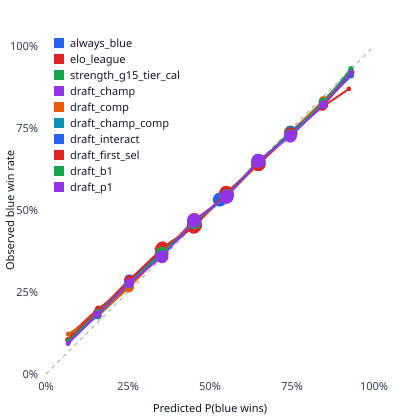

# Win-model evaluation run `20261112-195011-fe68c84652`

Walk-forward evaluation before the frozen holdout · games 2025-01-11 to 2026-05-11 · 14,456 games in 7,044 series · holdout starts 2026-05-12 · data cutoff 2026-11-12 · seed 0 · code fe68c84652 · A4: draft ablation, offset = strength_g15_tier_cal (coefficient fixed at 1), draft coefficients refitted monthly from 2023

Each day's games are predicted by models refitted on all earlier days. Intervals are 95% bootstrap intervals resampling whole series; "vs baseline" rows are paired differences (negative = better than `strength_g15_tier_cal`).

## All leagues (14,456 games)

| Model | Log-loss | Brier | Accuracy | AUC | Calibration slope | ECE |
|---|---|---|---|---|---|---|
| always_blue | 0.6912 [0.6903, 0.6921] | 0.2490 [0.2486, 0.2495] | 53.2% [52.4%, 53.9%] | — | — | 0.0017 [0.0001, 0.0097] |
| elo_league | 0.6381 [0.6319, 0.6444] | 0.2236 [0.2209, 0.2263] | 63.2% [62.4%, 64.1%] | 0.6827 [0.6735, 0.6914] | 0.8852 [0.8295, 0.9397] | 0.0108 [0.0090, 0.0209] |
| strength_g15_tier_cal | 0.6219 [0.6157, 0.6282] | 0.2167 [0.2140, 0.2194] | 64.7% [63.9%, 65.5%] | 0.7057 [0.6978, 0.7135] | 0.9195 [0.8799, 0.9645] | 0.0104 [0.0078, 0.0184] |
| draft_champ | 0.6182 [0.6117, 0.6249] | 0.2150 [0.2122, 0.2179] | 65.4% [64.6%, 66.3%] | 0.7119 [0.7039, 0.7197] | 0.9000 [0.8604, 0.9426] | 0.0112 [0.0091, 0.0195] |
| draft_comp | 0.6214 [0.6152, 0.6277] | 0.2164 [0.2137, 0.2192] | 64.6% [63.8%, 65.5%] | 0.7064 [0.6986, 0.7142] | 0.9200 [0.8798, 0.9676] | 0.0120 [0.0077, 0.0200] |
| draft_champ_comp | 0.6182 [0.6117, 0.6249] | 0.2150 [0.2122, 0.2179] | 65.4% [64.5%, 66.2%] | 0.7120 [0.7040, 0.7198] | 0.8990 [0.8592, 0.9415] | 0.0118 [0.0091, 0.0200] |
| draft_interact | 0.6185 [0.6120, 0.6251] | 0.2151 [0.2123, 0.2179] | 65.4% [64.6%, 66.2%] | 0.7118 [0.7039, 0.7196] | 0.8959 [0.8566, 0.9380] | 0.0115 [0.0089, 0.0200] |
| draft_first_sel | 0.6186 [0.6121, 0.6254] | 0.2152 [0.2123, 0.2181] | 65.5% [64.6%, 66.3%] | 0.7117 [0.7036, 0.7196] | 0.8820 [0.8418, 0.9213] | 0.0141 [0.0117, 0.0225] |
| draft_b1 | 0.6220 [0.6158, 0.6283] | 0.2167 [0.2140, 0.2195] | 64.7% [63.9%, 65.6%] | 0.7058 [0.6981, 0.7136] | 0.9131 [0.8725, 0.9592] | 0.0123 [0.0080, 0.0196] |
| draft_p1 | 0.6202 [0.6138, 0.6266] | 0.2159 [0.2131, 0.2187] | 65.0% [64.2%, 65.8%] | 0.7088 [0.7008, 0.7165] | 0.9053 [0.8644, 0.9493] | 0.0130 [0.0091, 0.0215] |

| Model | Log-loss vs baseline | Brier vs baseline |
|---|---|---|
| always_blue | +0.0692 [+0.0631, +0.0756] | +0.0323 [+0.0296, +0.0352] |
| elo_league | +0.0162 [+0.0120, +0.0203] | +0.0070 [+0.0051, +0.0087] |
| draft_champ | -0.0037 [-0.0052, -0.0021] | -0.0017 [-0.0023, -0.0010] |
| draft_comp | -0.0005 [-0.0010, +0.0000] | -0.0002 [-0.0004, +0.0000] |
| draft_champ_comp | -0.0037 [-0.0053, -0.0020] | -0.0017 [-0.0024, -0.0009] |
| draft_interact | -0.0034 [-0.0051, -0.0017] | -0.0016 [-0.0023, -0.0008] |
| draft_first_sel | -0.0033 [-0.0051, -0.0015] | -0.0015 [-0.0023, -0.0007] |
| draft_b1 | +0.0001 [-0.0005, +0.0007] | +0.0001 [-0.0002, +0.0003] |
| draft_p1 | -0.0017 [-0.0029, -0.0006] | -0.0008 [-0.0013, -0.0003] |

## Major leagues (+ Worlds/MSI/FST/EWC) (4,056 games)

| Model | Log-loss | Brier | Accuracy | AUC | Calibration slope | ECE |
|---|---|---|---|---|---|---|
| always_blue | 0.6913 [0.6894, 0.6932] | 0.2491 [0.2481, 0.2500] | 53.1% [51.5%, 54.7%] | — | — | 0.0009 [0.0003, 0.0169] |
| elo_league | 0.6347 [0.6217, 0.6470] | 0.2220 [0.2164, 0.2274] | 63.9% [62.2%, 65.6%] | 0.6917 [0.6759, 0.7101] | 0.8211 [0.7544, 0.9111] | 0.0242 [0.0179, 0.0401] |
| strength_g15_tier_cal | 0.6306 [0.6186, 0.6420] | 0.2202 [0.2149, 0.2252] | 64.2% [62.7%, 65.9%] | 0.6955 [0.6791, 0.7142] | 0.9260 [0.8396, 1.0281] | 0.0128 [0.0114, 0.0316] |
| draft_champ | 0.6272 [0.6152, 0.6387] | 0.2188 [0.2134, 0.2240] | 65.0% [63.5%, 66.6%] | 0.7009 [0.6851, 0.7198] | 0.9026 [0.8223, 0.9951] | 0.0175 [0.0142, 0.0354] |
| draft_comp | 0.6295 [0.6175, 0.6409] | 0.2198 [0.2143, 0.2249] | 64.2% [62.6%, 65.8%] | 0.6968 [0.6815, 0.7160] | 0.9327 [0.8477, 1.0332] | 0.0144 [0.0111, 0.0310] |
| draft_champ_comp | 0.6268 [0.6147, 0.6381] | 0.2186 [0.2132, 0.2238] | 65.1% [63.5%, 66.7%] | 0.7015 [0.6860, 0.7199] | 0.9051 [0.8240, 0.9993] | 0.0132 [0.0136, 0.0335] |
| draft_interact | 0.6272 [0.6150, 0.6386] | 0.2188 [0.2134, 0.2239] | 65.2% [63.6%, 66.8%] | 0.7011 [0.6853, 0.7196] | 0.8994 [0.8163, 0.9936] | 0.0199 [0.0155, 0.0351] |
| draft_first_sel | 0.6291 [0.6169, 0.6407] | 0.2196 [0.2143, 0.2248] | 64.7% [63.2%, 66.3%] | 0.6983 [0.6823, 0.7164] | 0.8812 [0.7991, 0.9719] | 0.0209 [0.0156, 0.0383] |
| draft_b1 | 0.6304 [0.6184, 0.6417] | 0.2202 [0.2148, 0.2252] | 64.0% [62.6%, 65.7%] | 0.6960 [0.6797, 0.7156] | 0.9211 [0.8324, 1.0252] | 0.0133 [0.0122, 0.0340] |
| draft_p1 | 0.6290 [0.6168, 0.6405] | 0.2196 [0.2141, 0.2246] | 64.6% [63.1%, 66.3%] | 0.6980 [0.6825, 0.7176] | 0.9118 [0.8290, 1.0118] | 0.0139 [0.0124, 0.0329] |

| Model | Log-loss vs baseline | Brier vs baseline |
|---|---|---|
| always_blue | +0.0607 [+0.0494, +0.0723] | +0.0288 [+0.0239, +0.0341] |
| elo_league | +0.0042 [-0.0015, +0.0100] | +0.0017 [-0.0006, +0.0042] |
| draft_champ | -0.0033 [-0.0061, -0.0006] | -0.0014 [-0.0026, -0.0002] |
| draft_comp | -0.0011 [-0.0021, -0.0002] | -0.0004 [-0.0009, -0.0000] |
| draft_champ_comp | -0.0038 [-0.0067, -0.0009] | -0.0016 [-0.0029, -0.0003] |
| draft_interact | -0.0034 [-0.0064, -0.0004] | -0.0015 [-0.0028, -0.0001] |
| draft_first_sel | -0.0015 [-0.0046, +0.0018] | -0.0006 [-0.0020, +0.0009] |
| draft_b1 | -0.0002 [-0.0013, +0.0008] | -0.0001 [-0.0006, +0.0004] |
| draft_p1 | -0.0016 [-0.0035, +0.0004] | -0.0006 [-0.0015, +0.0002] |

## ERLs (EMEA regional + EMEA Masters) (5,072 games)

| Model | Log-loss | Brier | Accuracy | AUC | Calibration slope | ECE |
|---|---|---|---|---|---|---|
| always_blue | 0.6902 [0.6886, 0.6918] | 0.2486 [0.2478, 0.2493] | 53.9% [52.6%, 55.2%] | — | — | 0.0094 [0.0006, 0.0231] |
| elo_league | 0.6307 [0.6204, 0.6413] | 0.2205 [0.2159, 0.2251] | 63.9% [62.5%, 65.4%] | 0.6904 [0.6735, 0.7062] | 0.9572 [0.8671, 1.0563] | 0.0125 [0.0110, 0.0290] |
| strength_g15_tier_cal | 0.6133 [0.6020, 0.6249] | 0.2133 [0.2083, 0.2183] | 65.4% [64.0%, 66.8%] | 0.7138 [0.7003, 0.7290] | 0.9604 [0.8965, 1.0426] | 0.0123 [0.0108, 0.0283] |
| draft_champ | 0.6088 [0.5973, 0.6210] | 0.2112 [0.2062, 0.2163] | 66.1% [64.7%, 67.5%] | 0.7206 [0.7073, 0.7341] | 0.9369 [0.8713, 1.0058] | 0.0141 [0.0116, 0.0288] |
| draft_comp | 0.6131 [0.6016, 0.6246] | 0.2131 [0.2082, 0.2182] | 65.0% [63.6%, 66.4%] | 0.7144 [0.7011, 0.7296] | 0.9569 [0.8926, 1.0377] | 0.0147 [0.0116, 0.0303] |
| draft_champ_comp | 0.6090 [0.5974, 0.6210] | 0.2112 [0.2063, 0.2165] | 66.2% [64.8%, 67.6%] | 0.7205 [0.7072, 0.7337] | 0.9340 [0.8684, 1.0041] | 0.0116 [0.0098, 0.0273] |
| draft_interact | 0.6088 [0.5974, 0.6209] | 0.2112 [0.2062, 0.2163] | 66.3% [64.9%, 67.7%] | 0.7206 [0.7071, 0.7336] | 0.9335 [0.8661, 1.0043] | 0.0133 [0.0098, 0.0283] |
| draft_first_sel | 0.6082 [0.5963, 0.6206] | 0.2109 [0.2058, 0.2161] | 66.5% [65.1%, 67.8%] | 0.7219 [0.7082, 0.7347] | 0.9208 [0.8581, 0.9878] | 0.0153 [0.0125, 0.0305] |
| draft_b1 | 0.6139 [0.6027, 0.6255] | 0.2135 [0.2087, 0.2185] | 65.4% [64.0%, 66.8%] | 0.7134 [0.7003, 0.7283] | 0.9487 [0.8848, 1.0258] | 0.0135 [0.0105, 0.0290] |
| draft_p1 | 0.6110 [0.5996, 0.6229] | 0.2122 [0.2073, 0.2173] | 65.7% [64.3%, 67.0%] | 0.7171 [0.7034, 0.7310] | 0.9425 [0.8776, 1.0161] | 0.0142 [0.0116, 0.0319] |

| Model | Log-loss vs baseline | Brier vs baseline |
|---|---|---|
| always_blue | +0.0769 [+0.0655, +0.0879] | +0.0353 [+0.0304, +0.0400] |
| elo_league | +0.0174 [+0.0106, +0.0245] | +0.0072 [+0.0042, +0.0104] |
| draft_champ | -0.0045 [-0.0070, -0.0019] | -0.0021 [-0.0032, -0.0009] |
| draft_comp | -0.0003 [-0.0012, +0.0007] | -0.0001 [-0.0005, +0.0003] |
| draft_champ_comp | -0.0044 [-0.0070, -0.0017] | -0.0020 [-0.0032, -0.0009] |
| draft_interact | -0.0045 [-0.0073, -0.0016] | -0.0021 [-0.0033, -0.0008] |
| draft_first_sel | -0.0051 [-0.0081, -0.0020] | -0.0024 [-0.0037, -0.0010] |
| draft_b1 | +0.0006 [-0.0004, +0.0016] | +0.0002 [-0.0002, +0.0007] |
| draft_p1 | -0.0023 [-0.0043, -0.0003] | -0.0011 [-0.0020, -0.0002] |

## Other leagues (5,328 games)

| Model | Log-loss | Brier | Accuracy | AUC | Calibration slope | ECE |
|---|---|---|---|---|---|---|
| always_blue | 0.6920 [0.6904, 0.6935] | 0.2494 [0.2486, 0.2502] | 52.5% [51.2%, 53.8%] | — | — | 0.0050 [0.0003, 0.0169] |
| elo_league | 0.6477 [0.6377, 0.6571] | 0.2279 [0.2236, 0.2321] | 62.1% [60.8%, 63.5%] | 0.6685 [0.6523, 0.6850] | 0.8875 [0.7929, 0.9960] | 0.0096 [0.0097, 0.0257] |
| strength_g15_tier_cal | 0.6235 [0.6122, 0.6345] | 0.2172 [0.2123, 0.2218] | 64.5% [63.2%, 65.8%] | 0.7057 [0.6919, 0.7198] | 0.8810 [0.8167, 0.9544] | 0.0165 [0.0121, 0.0318] |
| draft_champ | 0.6204 [0.6086, 0.6315] | 0.2157 [0.2108, 0.2205] | 65.1% [63.8%, 66.4%] | 0.7116 [0.6990, 0.7253] | 0.8674 [0.8085, 0.9394] | 0.0181 [0.0137, 0.0330] |
| draft_comp | 0.6232 [0.6119, 0.6342] | 0.2170 [0.2122, 0.2217] | 64.6% [63.2%, 65.9%] | 0.7062 [0.6926, 0.7202] | 0.8806 [0.8167, 0.9550] | 0.0161 [0.0117, 0.0292] |
| draft_champ_comp | 0.6206 [0.6088, 0.6316] | 0.2158 [0.2108, 0.2205] | 64.8% [63.5%, 66.2%] | 0.7113 [0.6990, 0.7249] | 0.8654 [0.8086, 0.9384] | 0.0219 [0.0164, 0.0360] |
| draft_interact | 0.6211 [0.6092, 0.6322] | 0.2159 [0.2109, 0.2206] | 64.8% [63.5%, 66.1%] | 0.7111 [0.6984, 0.7251] | 0.8615 [0.8053, 0.9355] | 0.0225 [0.0162, 0.0366] |
| draft_first_sel | 0.6206 [0.6089, 0.6319] | 0.2158 [0.2106, 0.2206] | 65.1% [63.8%, 66.4%] | 0.7116 [0.6985, 0.7250] | 0.8505 [0.7919, 0.9177] | 0.0194 [0.0154, 0.0336] |
| draft_b1 | 0.6235 [0.6121, 0.6345] | 0.2172 [0.2123, 0.2219] | 64.6% [63.3%, 66.0%] | 0.7057 [0.6922, 0.7193] | 0.8765 [0.8140, 0.9506] | 0.0175 [0.0140, 0.0325] |
| draft_p1 | 0.6222 [0.6104, 0.6335] | 0.2165 [0.2116, 0.2213] | 64.7% [63.4%, 66.0%] | 0.7089 [0.6959, 0.7232] | 0.8686 [0.8061, 0.9407] | 0.0221 [0.0168, 0.0367] |

| Model | Log-loss vs baseline | Brier vs baseline |
|---|---|---|
| always_blue | +0.0685 [+0.0574, +0.0800] | +0.0322 [+0.0275, +0.0371] |
| elo_league | +0.0242 [+0.0166, +0.0316] | +0.0107 [+0.0075, +0.0138] |
| draft_champ | -0.0032 [-0.0057, -0.0005] | -0.0015 [-0.0026, -0.0003] |
| draft_comp | -0.0003 [-0.0012, +0.0006] | -0.0002 [-0.0006, +0.0002] |
| draft_champ_comp | -0.0030 [-0.0056, -0.0002] | -0.0014 [-0.0026, -0.0002] |
| draft_interact | -0.0024 [-0.0051, +0.0003] | -0.0013 [-0.0025, -0.0001] |
| draft_first_sel | -0.0029 [-0.0057, +0.0001] | -0.0014 [-0.0026, -0.0001] |
| draft_b1 | -0.0001 [-0.0010, +0.0009] | +0.0000 [-0.0004, +0.0004] |
| draft_p1 | -0.0013 [-0.0033, +0.0006] | -0.0006 [-0.0015, +0.0002] |

## Calibration (all leagues)

| Model | 0.0-0.1 | 0.1-0.2 | 0.2-0.3 | 0.3-0.4 | 0.4-0.5 | 0.5-0.6 | 0.6-0.7 | 0.7-0.8 | 0.8-0.9 | 0.9-1.0 |
|---|---|---|---|---|---|---|---|---|---|---|
| always_blue (observed / predicted, n) | — | — | — | — | — | 0.53 / 0.53 (14456) | — | — | — | — |
| elo_league (observed / predicted, n) | 0.12 / 0.08 (82) | 0.20 / 0.16 (472) | 0.27 / 0.25 (969) | 0.39 / 0.35 (1740) | 0.45 / 0.45 (2791) | 0.55 / 0.55 (3490) | 0.64 / 0.65 (2535) | 0.74 / 0.75 (1437) | 0.81 / 0.84 (764) | 0.87 / 0.92 (176) |
| strength_g15_tier_cal (observed / predicted, n) | 0.12 / 0.07 (139) | 0.18 / 0.16 (632) | 0.27 / 0.25 (1083) | 0.37 / 0.35 (1776) | 0.46 / 0.45 (2493) | 0.54 / 0.55 (3018) | 0.64 / 0.65 (2450) | 0.74 / 0.74 (1665) | 0.82 / 0.84 (925) | 0.93 / 0.93 (275) |
| draft_champ (observed / predicted, n) | 0.10 / 0.07 (166) | 0.18 / 0.16 (690) | 0.29 / 0.25 (1169) | 0.37 / 0.35 (1781) | 0.45 / 0.45 (2381) | 0.55 / 0.55 (2803) | 0.64 / 0.65 (2395) | 0.73 / 0.75 (1723) | 0.82 / 0.85 (1014) | 0.92 / 0.93 (334) |
| draft_comp (observed / predicted, n) | 0.12 / 0.07 (140) | 0.18 / 0.16 (628) | 0.26 / 0.25 (1112) | 0.37 / 0.35 (1767) | 0.47 / 0.45 (2510) | 0.54 / 0.55 (2973) | 0.64 / 0.65 (2457) | 0.74 / 0.75 (1673) | 0.83 / 0.85 (922) | 0.92 / 0.93 (274) |
| draft_champ_comp (observed / predicted, n) | 0.10 / 0.07 (174) | 0.18 / 0.16 (685) | 0.28 / 0.25 (1162) | 0.36 / 0.35 (1791) | 0.46 / 0.45 (2392) | 0.54 / 0.55 (2780) | 0.65 / 0.65 (2431) | 0.73 / 0.75 (1687) | 0.82 / 0.85 (1018) | 0.92 / 0.93 (336) |
| draft_interact (observed / predicted, n) | 0.10 / 0.07 (184) | 0.18 / 0.16 (675) | 0.29 / 0.25 (1167) | 0.37 / 0.35 (1778) | 0.45 / 0.45 (2442) | 0.55 / 0.55 (2731) | 0.64 / 0.65 (2439) | 0.74 / 0.75 (1701) | 0.82 / 0.85 (972) | 0.91 / 0.93 (367) |
| draft_first_sel (observed / predicted, n) | 0.11 / 0.07 (190) | 0.19 / 0.16 (721) | 0.29 / 0.25 (1203) | 0.38 / 0.35 (1768) | 0.45 / 0.45 (2367) | 0.55 / 0.55 (2742) | 0.64 / 0.65 (2363) | 0.73 / 0.75 (1730) | 0.82 / 0.85 (1011) | 0.92 / 0.93 (361) |
| draft_b1 (observed / predicted, n) | 0.10 / 0.07 (139) | 0.19 / 0.16 (638) | 0.28 / 0.25 (1126) | 0.37 / 0.35 (1786) | 0.46 / 0.45 (2476) | 0.54 / 0.55 (2963) | 0.65 / 0.65 (2466) | 0.73 / 0.74 (1664) | 0.83 / 0.84 (920) | 0.92 / 0.93 (278) |
| draft_p1 (observed / predicted, n) | 0.09 / 0.07 (151) | 0.18 / 0.16 (671) | 0.28 / 0.25 (1147) | 0.36 / 0.35 (1746) | 0.47 / 0.45 (2393) | 0.54 / 0.55 (2915) | 0.65 / 0.65 (2433) | 0.72 / 0.74 (1708) | 0.82 / 0.85 (971) | 0.92 / 0.93 (321) |

## Roster changes

528 of 14,456 evaluated games (3.7%) involve a team that changed 3 or more players since its previous game. Strength is keyed by team name, so those games start from a rating earned by a different roster.

## Models

- **always_blue**: params {}; features: side
- **elo_league**: params {'k': 24.0}; features: (elo + league offset) diff/400, offsets refitted monthly on past games; intercept = side
- **strength_g15_tier_cal**: params {'form_half_life': 10.0, 'weight_half_life_days': 90, 'lam_team': 0.1, 'lam_league': 0.1, 'lam_dense': 0.001, 'window_days': 1460.0, 'margin_k': 0.16, 'w_major': 0.25, 'logit_scale': 0.9055}; features: side (intercept); first pick (+1 blue / -1 red, 2026 only); tier-weighted gold-lead-at-15 (k gold; W/L where no gold data) rating difference (online, k=0.16, past games only); margin weight majors 0.25, ERL/Other 1; team effects shrunk to league mean (ridge); league effects (home league, cross-league games); temperature scaling: logit x 0.905 (fitted on 2024 only)
  - coefficients at the last daily refit (logit scale): side +0.108, first_pick -0.079, margin_rating +0.299
  - *Caveat:* First pick is a separate term only from 2026 (Riot's First Selection rule). Before 2026 first pick was always blue side, so it is folded into the side term and CANNOT be estimated in the 2024 tuning window or in 2025; any first-pick coefficient comes from 2026 games only.
- **draft_champ**: params {'base': 'strength_g15_tier_cal', 'lam': 1.0, 'stage': 'full', 'interact': False}; features: OFFSET: strength_g15_tier_cal walk-forward logit (coefficient fixed at 1); champ: champ_strength, player_comfort, synergy, lane_counter, team_matchups; draft coefficients refitted monthly from 2023-01-01, ridge lam=1.0 (standardised)
  - coefficients at the last daily refit (logit scale): champ_strength +0.148, player_comfort +0.084, synergy +0.025, lane_counter +0.033, team_matchups +0.027
  - *Caveat:* 2026 red-first-pick games have no partial-draft (b1/p1) features until the C0 pick-order fix.
- **draft_comp**: params {'base': 'strength_g15_tier_cal', 'lam': 1.0, 'stage': 'full', 'interact': False}; features: OFFSET: strength_g15_tier_cal walk-forward logit (coefficient fixed at 1); comp: timing_diff, timing_gap, style_adv, hv_diff, early_diff; draft coefficients refitted monthly from 2023-01-01, ridge lam=1.0 (standardised)
  - coefficients at the last daily refit (logit scale): timing_diff -0.001, timing_gap +0.007, style_adv +0.044, hv_diff +0.048, early_diff +0.030
  - *Caveat:* 2026 red-first-pick games have no partial-draft (b1/p1) features until the C0 pick-order fix.
- **draft_champ_comp**: params {'base': 'strength_g15_tier_cal', 'lam': 1.0, 'stage': 'full', 'interact': False}; features: OFFSET: strength_g15_tier_cal walk-forward logit (coefficient fixed at 1); champ: champ_strength, player_comfort, synergy, lane_counter, team_matchups; comp: timing_diff, timing_gap, style_adv, hv_diff, early_diff; draft coefficients refitted monthly from 2023-01-01, ridge lam=1.0 (standardised)
  - coefficients at the last daily refit (logit scale): champ_strength +0.144, player_comfort +0.083, synergy +0.022, lane_counter +0.032, team_matchups +0.027, timing_diff +0.001, timing_gap +0.007, style_adv +0.029, hv_diff +0.030, early_diff +0.001
  - *Caveat:* 2026 red-first-pick games have no partial-draft (b1/p1) features until the C0 pick-order fix.
- **draft_interact**: params {'base': 'strength_g15_tier_cal', 'lam': 1.0, 'stage': 'full', 'interact': True}; features: OFFSET: strength_g15_tier_cal walk-forward logit (coefficient fixed at 1); champ: champ_strength, player_comfort, synergy, lane_counter, team_matchups; comp: timing_diff, timing_gap, style_adv, hv_diff, early_diff; champion features x |strength gap|; timing, high-variance share, style matchup x signed gap; draft coefficients refitted monthly from 2023-01-01, ridge lam=1.0 (standardised)
  - coefficients at the last daily refit (logit scale): champ_strength +0.155, player_comfort +0.083, synergy +0.007, lane_counter +0.021, team_matchups +0.061, timing_diff +0.001, timing_gap +0.007, style_adv +0.030, hv_diff +0.031, early_diff +0.001, champ_strength x |gap| -0.018, player_comfort x |gap| +0.001, synergy x |gap| +0.025, lane_counter x |gap| +0.017, team_matchups x |gap| -0.054, timing_diff x gap +0.011, hv_diff x gap +0.024, style_adv x gap -0.001
  - *Caveat:* 2026 red-first-pick games have no partial-draft (b1/p1) features until the C0 pick-order fix.
- **draft_first_sel**: params {'base': 'strength_g15_tier_cal', 'lam': 1.0, 'stage': 'full', 'interact': False}; features: OFFSET: strength_g15_tier_cal walk-forward logit (coefficient fixed at 1); champ: champ_strength, player_comfort, synergy, lane_counter, team_matchups; first_sel: fs_blue, fs_got_side_and_pick, fs_got_one, fs_got_neither; draft coefficients refitted monthly from 2023-01-01, ridge lam=1.0 (standardised)
  - coefficients at the last daily refit (logit scale): champ_strength +0.148, player_comfort +0.084, synergy +0.025, lane_counter +0.033, team_matchups +0.027, fs_blue -0.016, fs_got_side_and_pick -0.021, fs_got_one +0.008, fs_got_neither -0.021
  - *Caveat:* 2026 red-first-pick games have no partial-draft (b1/p1) features until the C0 pick-order fix.
  - *Caveat:* First Selection: who had it is known only for 2026 games 2+ (loser of the previous game); whether that team chose side or pick order is NOT identifiable from Oracle's Elixir data, so the features describe what it ended up with.
- **draft_b1**: params {'base': 'strength_g15_tier_cal', 'lam': 1.0, 'stage': 'b1', 'interact': False}; features: OFFSET: strength_g15_tier_cal walk-forward logit (coefficient fixed at 1); champ: b1_champ_strength, b1_player_comfort, b1_synergy, b1_lane_counter, b1_team_matchups; draft coefficients refitted monthly from 2023-01-01, ridge lam=1.0 (standardised)
  - coefficients at the last daily refit (logit scale): b1_champ_strength +0.067, b1_player_comfort +0.037, b1_synergy +0.000, b1_lane_counter +0.000, b1_team_matchups +0.000
  - *Caveat:* 2026 red-first-pick games have no partial-draft (b1/p1) features until the C0 pick-order fix.
- **draft_p1**: params {'base': 'strength_g15_tier_cal', 'lam': 1.0, 'stage': 'p1', 'interact': False}; features: OFFSET: strength_g15_tier_cal walk-forward logit (coefficient fixed at 1); champ: p1_champ_strength, p1_player_comfort, p1_synergy, p1_lane_counter, p1_team_matchups; draft coefficients refitted monthly from 2023-01-01, ridge lam=1.0 (standardised)
  - coefficients at the last daily refit (logit scale): p1_champ_strength +0.122, p1_player_comfort +0.084, p1_synergy +0.028, p1_lane_counter +0.007, p1_team_matchups +0.018
  - *Caveat:* 2026 red-first-pick games have no partial-draft (b1/p1) features until the C0 pick-order fix.
## A4: draft gain over the strength offset (log-loss, draft model minus `strength_g15_tier_cal`, series-level 95% bootstrap; negative = draft helps)

| Split | n | draft_champ | draft_comp | draft_champ_comp | draft_interact | draft_first_sel | draft_b1 | draft_p1 |
|---|---|---|---|---|---|---|---|---|
| All | 14,456 | -0.0037 [-0.0052, -0.0021] | -0.0005 [-0.0010, +0.0000] | -0.0037 [-0.0053, -0.0020] | -0.0034 [-0.0051, -0.0017] | -0.0033 [-0.0051, -0.0015] | +0.0001 [-0.0005, +0.0007] | -0.0017 [-0.0029, -0.0006] |
| Game 1 | 7,026 | -0.0053 [-0.0074, -0.0030] | -0.0005 [-0.0012, +0.0002] | -0.0052 [-0.0073, -0.0028] | -0.0045 [-0.0067, -0.0021] | -0.0053 [-0.0074, -0.0030] | -0.0000 [-0.0009, +0.0008] | -0.0019 [-0.0036, -0.0003] |
| Game 2 | 4,398 | -0.0021 [-0.0047, +0.0007] | -0.0010 [-0.0019, -0.0001] | -0.0026 [-0.0053, +0.0003] | -0.0027 [-0.0055, +0.0002] | -0.0025 [-0.0060, +0.0010] | -0.0003 [-0.0013, +0.0007] | -0.0015 [-0.0035, +0.0005] |
| Games 3-5 | 3,032 | -0.0023 [-0.0056, +0.0012] | +0.0002 [-0.0009, +0.0014] | -0.0019 [-0.0052, +0.0017] | -0.0019 [-0.0053, +0.0017] | +0.0002 [-0.0040, +0.0044] | +0.0011 [-0.0001, +0.0023] | -0.0016 [-0.0040, +0.0009] |
| Fearless games 3-5 | 2,960 | -0.0026 [-0.0057, +0.0006] | +0.0001 [-0.0010, +0.0013] | -0.0022 [-0.0056, +0.0011] | -0.0023 [-0.0057, +0.0012] | +0.0001 [-0.0041, +0.0044] | +0.0010 [-0.0003, +0.0023] | -0.0020 [-0.0044, +0.0007] |
| Major | 4,056 | -0.0033 [-0.0061, -0.0006] | -0.0011 [-0.0021, -0.0002] | -0.0038 [-0.0067, -0.0009] | -0.0034 [-0.0064, -0.0004] | -0.0015 [-0.0046, +0.0018] | -0.0002 [-0.0013, +0.0008] | -0.0016 [-0.0035, +0.0004] |
| ERL | 5,072 | -0.0045 [-0.0070, -0.0019] | -0.0003 [-0.0012, +0.0007] | -0.0044 [-0.0070, -0.0017] | -0.0045 [-0.0073, -0.0016] | -0.0051 [-0.0081, -0.0020] | +0.0006 [-0.0004, +0.0016] | -0.0023 [-0.0043, -0.0003] |
| Other | 5,328 | -0.0032 [-0.0057, -0.0005] | -0.0003 [-0.0012, +0.0006] | -0.0030 [-0.0056, -0.0002] | -0.0024 [-0.0051, +0.0003] | -0.0029 [-0.0057, +0.0001] | -0.0001 [-0.0010, +0.0009] | -0.0013 [-0.0033, +0.0006] |
| 2026 | 4,412 | -0.0057 [-0.0084, -0.0029] | -0.0007 [-0.0016, +0.0003] | -0.0057 [-0.0085, -0.0028] | -0.0055 [-0.0083, -0.0026] | -0.0044 [-0.0084, -0.0001] | -0.0002 [-0.0010, +0.0006] | -0.0018 [-0.0036, +0.0001] |

### By draft stage (same games: every game with a recorded pick order; 2026 red-first-pick games excluded until the C0 fix)

| Stage | n | gain vs base |
|---|---|---|
| After B1 (7 actions) | 13,102 | +0.0001 [-0.0005, +0.0008] |
| After pick phase 1 (12 actions) | 13,102 | -0.0019 [-0.0031, -0.0007] |
| Full draft | 13,102 | -0.0034 [-0.0050, -0.0018] |

## A4 analysis

### 1. Draft coefficients (draft_interact, refitted once on 35,758 games 2023-01-01 to the holdout; offset = `strength_g15_tier_cal`; 300 series bootstrap draws)

Natural units: logit change per 1 unit of the feature (per 1 unit x 1 logit of strength gap for interactions; gap > 0 = blue favoured). 1 logit near 50% is about 23 percentage points.

| Term | Coefficient | 95% CI | Per 1 SD (logit) | Hypothesis |
|---|---|---|---|---|
| champion strength | +8.372 * | [+6.006, +10.469] | +0.157 |  |
| player comfort | +0.139 * | [+0.083, +0.197] | +0.085 |  |
| synergy | +0.058 | [-1.876, +2.677] | +0.001 |  |
| lane counter | +1.375 | [-0.772, +3.832] | +0.025 |  |
| whole-team matchups | +8.138 * | [+3.189, +13.789] | +0.057 |  |
| comp timing (blue later by 1 tag-sheet step) | -0.004 | [-0.070, +0.053] | -0.001 |  |
| timing mismatch size | +0.009 | [-0.047, +0.061] | +0.002 |  |
| style matchup (tag sheet) | +0.406 * | [+0.103, +0.758] | +0.030 |  |
| high-variance share (blue - red) | +0.064 * | [+0.010, +0.119] | +0.028 |  |
| data early score (k gold @15) | -0.001 | [-0.042, +0.047] | -0.000 |  |
| champion strength x |gap| | -1.070 | [-4.170, +2.151] | -0.018 |  |
| player comfort x |gap| | +0.002 | [-0.068, +0.083] | +0.002 |  |
| synergy x |gap| | +1.787 | [-1.627, +4.771] | +0.031 |  |
| lane counter x |gap| | +0.938 | [-2.600, +4.113] | +0.015 |  |
| whole-team matchups x |gap| | -7.545 * | [-15.473, -0.004] | -0.048 |  |
| comp timing (blue later by 1 tag-sheet step) x gap | +0.034 | [-0.043, +0.128] | +0.012 | > 0 (favourite gains from the later comp) |
| high-variance share (blue - red) x gap | +0.065 | [-0.012, +0.143] | +0.025 | < 0 (underdog gains from high variance) |
| style matchup (tag sheet) x gap | -0.014 | [-0.443, +0.402] | -0.001 |  |

\* = 95% CI excludes 0.

### 2. Level-strength draft win probability (strength gap = 0, no side term)

14,456 evaluated games. How far the draft alone moves an even matchup:

| Statistic | Value |
|---|---|
| median distance from 50% | 3.7 pp |
| 90th percentile | 8.9 pp |
| largest | 19.1 pp |
| share outside 45-55% | 35.5% |
| share outside 40-60% | 6.0% |
| observed blue win rate when level-draft favours blue by > 5 pp | 63.2% (n=2,917) |
| ... when it favours red by > 5 pp | 41.5% (n=2,222) |

App use: `draftlab.winmodels.draft.level_strength_prob(model, features)` after fitting; the coefficients above are the ones it applies.

### 3. Residual check (out-of-sample 2025 predictions)

Edge = draft model probability minus strength-only probability (for the blue side). If the draft edge is real, games where the draft favours blue should beat the strength-only prediction.

**draft_champ_comp**

| Draft-edge quintile | n | mean edge | strength-only predicted | observed | observed - predicted (95% CI) |
|---|---|---|---|---|---|
| Q1 | 2,892 | -6.4 pp | 50.8% | 44.6% | -6.1 pp [-7.9, -4.4] |
| Q2 | 2,891 | -2.3 pp | 50.3% | 47.4% | -3.0 pp [-4.6, -1.3] |
| Q3 | 2,891 | +0.0 pp | 53.6% | 55.9% | +2.3 pp [+0.6, +4.0] |
| Q4 | 2,891 | +2.3 pp | 56.3% | 58.7% | +2.5 pp [+0.7, +4.2] |
| Q5 | 2,891 | +6.3 pp | 54.0% | 59.1% | +5.1 pp [+3.5, +6.8] |

Slope of (result - strength prediction) on draft edge: **0.90** [0.72, 1.08] (1 = edge fully real, 0 = noise).

**draft_interact**

| Draft-edge quintile | n | mean edge | strength-only predicted | observed | observed - predicted (95% CI) |
|---|---|---|---|---|---|
| Q1 | 2,892 | -6.5 pp | 51.9% | 45.0% | -6.8 pp [-8.5, -5.1] |
| Q2 | 2,891 | -2.3 pp | 49.5% | 48.1% | -1.4 pp [-3.0, +0.3] |
| Q3 | 2,891 | -0.0 pp | 52.8% | 53.8% | +1.1 pp [-0.7, +2.7] |
| Q4 | 2,891 | +2.4 pp | 56.2% | 59.0% | +2.9 pp [+1.2, +4.5] |
| Q5 | 2,891 | +6.4 pp | 54.7% | 59.8% | +5.1 pp [+3.3, +6.8] |

Slope of (result - strength prediction) on draft edge: **0.88** [0.70, 1.04] (1 = edge fully real, 0 = noise).

**draft_champ**

| Draft-edge quintile | n | mean edge | strength-only predicted | observed | observed - predicted (95% CI) |
|---|---|---|---|---|---|
| Q1 | 2,892 | -6.1 pp | 51.0% | 44.7% | -6.3 pp [-8.0, -4.5] |
| Q2 | 2,891 | -2.1 pp | 50.0% | 47.1% | -2.9 pp [-4.6, -1.2] |
| Q3 | 2,891 | +0.1 pp | 53.5% | 55.7% | +2.2 pp [+0.6, +3.8] |
| Q4 | 2,891 | +2.3 pp | 56.3% | 58.8% | +2.6 pp [+0.9, +4.2] |
| Q5 | 2,891 | +6.1 pp | 54.3% | 59.5% | +5.2 pp [+3.5, +7.0] |

Slope of (result - strength prediction) on draft edge: **0.94** [0.76, 1.11] (1 = edge fully real, 0 = noise).

